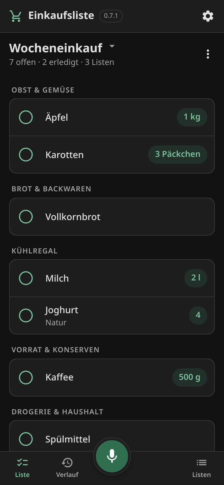
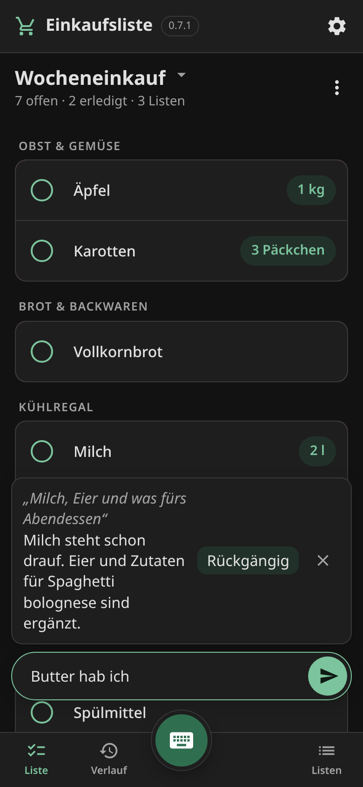
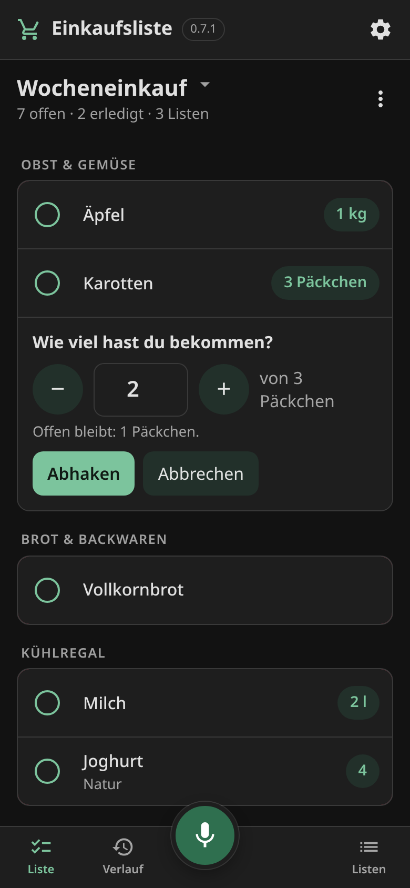
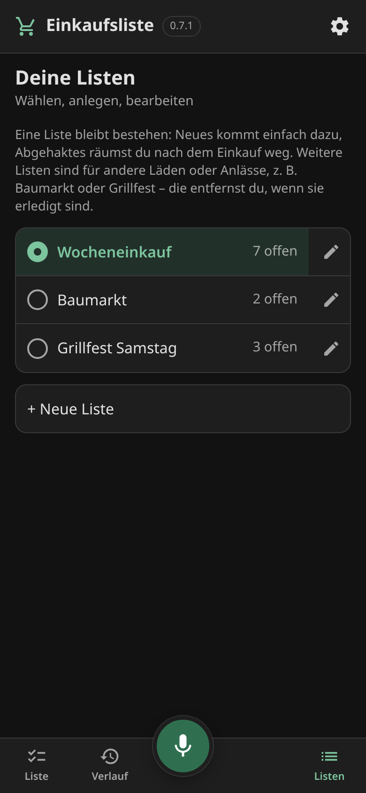

# shopping-pantry

Eine gemeinsame Einkaufsliste für den Haushalt, auf dem Handy. Ein paar Wörter sagen oder
tippen – *„Milch, was fürs Abendessen, Spülmittel, Holzleim“* – und eine KI macht daraus eine
sortierte Liste mit Mengen. Alle im Heimnetz sehen dieselbe Liste, live, und haken im Laden ab.

Die Schwester von [inventree-pantry](https://github.com/setuun/inventree-pantry). Wenn beide da
sind, arbeiten sie zusammen: Die Liste weiß, was schon im Vorrat ist, kann sich aus dem füllen,
was im Vorrat fehlt, und bucht Gekauftes in den Vorrat ein – nur den Teil, der dort hingehört.

English: [README.md](README.md)

  
  
  
  

> [!IMPORTANT]
> **Diese App ist „vibe-coded“.** Sie wurde fast vollständig von einem KI-Agenten (Claude Code)
> geschrieben, angeleitet von einer Person, für einen Haushalt. Jede Änderung wurde an einem
> echten Aufbau geprüft, aber kein Mensch hat den Code Zeile für Zeile durchgesehen. Vor dem
> Einsatz lesen.
>
> **Die Installationsanleitung ist für einen KI-Agenten geschrieben.** Den eigenen Agenten
> (Claude Code, Codex, Gemini CLI, …) auf [INSTALL.md](INSTALL.md) ansetzen und arbeiten lassen.
> Er prüft seine Schritte selbst und fragt, wo eine Entscheidung bei dir liegt.

## Was sie kann

- **Listen für alles.** Wocheneinkauf, Drogerie, Baumarkt: mehrere Listen nebeneinander, nicht
  nur Lebensmittel.
- **Nur einen Teil bekommen?** Aufs Mengen-Label rechts tippen („3 Päckchen“), sagen, wie viel
  es waren; der Rest bleibt auf der Liste.
- **Live auf jedem Handy.** Im Laden abgehakt, zu Hause einen Moment später abgehakt. Keine
  Anmeldung: Das Netz ist die Grenze. Jedes Gerät gibt sich einmal einen Namen, damit man sieht,
  wer was eingetragen oder abgehakt hat.
- **KI, optional: sag, was zu tun ist.** Eine Zeile unten, getippt oder gesprochen, steuert die
  ganze App: *„Milch und Eier“*, *„Brot und Butter hab ich“*, *„die Schrauben kommen auf die
  Baumarkt-Liste“*, *„mach 3 Liter draus“*, *„neue Liste fürs Grillen am Samstag mit Würstchen
  und Kohle“*, *„Zutaten für Lasagne für vier“*, *„das Übliche“*, *„was hab ich vergessen?“*.
  Das läuft sofort und antwortet in einer Zeile mit **Rückgängig**; ist ein Befehl unklar, fragt
  sie nach statt zu raten. Antworten können vorgelesen werden. Jeder OpenAI-kompatible Server
  geht (llama.cpp, Ollama, vLLM, LM Studio, OpenAI), oder Anthropic.
- **Spracheingabe, optional.** Ein runder Mikrofonknopf neben der Befehlszeile; nach zehn
  Sekunden Stille hört er von selbst auf. Die Aufnahme geht über den
  Server an einen OpenAI-kompatiblen Transkriptionsdienst (whisper.cpp, faster-whisper, OpenAI);
  Adresse und Passwort sieht kein Handy.
- **Ohne beides ist es eine einfache gemeinsame Liste:** jedes Komma, jede Zeile ein Eintrag.

## Zusammen mit inventree-pantry (optional)

Die Vorrats-App führt den Bestand in [InvenTree](https://inventree.org); ihre eigene
Einkaufsliste dreht sich nur um den Vorrat. Diese App ist die Liste für jeden Tag und schlägt
eine Brücke:

- **Fragen:** *„Haben wir noch Reis?“* beantwortet sie aus InvenTree, und ein Rezept lässt weg,
  was der Vorrat schon hat.
- **Beim Schreiben:** Die Antwort sagt, was der Vorrat schon hat – *„im Vorrat: 9 l
  Mandeldrink“* –, „trotzdem kaufen?“ ist also ein Blick. Geschrieben wird dabei nichts.
- **„Fehlt im Vorrat“** übernimmt, was InvenTree unter dem Sollbestand meldet, als Vorschlag.
- **Nach dem Einkauf:** *„6 Mandelmilch in den Vorrat“* sagen oder bei einem abgehakten Eintrag
  auf *„In den Vorrat?“* tippen. Den passenden Artikel
  hat die KI schon gefunden. Du sagst, wie viel vom Gekauften in den Vorrat geht – *10 gekauft,
  6 in den Vorrat, 4 bleiben in der Küche* –, und nur das wird gebucht, mit Lagerort und MHD.
  Baumarktsachen oder das Brot für morgen werden nur abgehakt.

Gebucht wird nach den Regeln der Vorrats-App, damit beide Apps dieselben Daten hinterlassen:
Bestand landet auf Produkten, nie auf Anforderungen; abgemessene Artikel werden als Packungen ×
Inhalt gebucht; eine neue Charge wird nur bei gleichem MHD mit einer vorhandenen zusammengelegt.

## Aufbau

Eine Python-Datei nur mit der Standardbibliothek – kein pip, kein Build, kein Framework – und
eine HTML-Datei fürs Handy. SQLite für die Listen, Server-Sent Events für den Live-Abgleich.
Läuft überall, wo Python 3.11 läuft, und braucht ein paar Megabyte Speicher.

Die Konfiguration ist eine JSON-Datei; jeder optionale Teil ist ein Block, der fehlen darf.
Siehe [examples/shopping.example.json](examples/shopping.example.json) und [INSTALL.md](INSTALL.md).

## KI anbinden (und die anderen optionalen Teile)

Wie bei der Fotoerkennung von inventree-pantry ist die KI das, was der Haushalt betreibt; die App
hat kein eigenes Konto. Sie bekommt eine Adresse, ein Modell und bei einem Cloud-Dienst einen
Schlüssel – im Block `ai` der Konfigurationsdatei (`api`, `url`, `model`, `timeout`, `extra`).
**Den Schlüssel nicht in die Datei schreiben**, sondern als Umgebungsvariable
`SHOPPING_AI_API_KEY` in `/etc/shopping-pantry/secrets.env` (liest die mitgelieferte systemd-Unit).
Genauso für die Spracheingabe (`SHOPPING_SPEECH_PASSWORD`) und die Vorrats-Brücke
(`SHOPPING_PANTRY_PASSWORD` oder `SHOPPING_PANTRY_TOKEN`). Ein weggelassener Block heißt: dieser
Teil ist nicht da. Details in [INSTALL.md](INSTALL.md) und der englischen README.

## Sicherheit

Keine Anmeldung, mit Absicht: Die App ist fürs Heimnetz (und ein VPN dorthin) gedacht, wie ein
Zettel an der Kühlschranktür. Nicht ins Internet stellen. Die Zugänge zu KI, Sprachdienst und
InvenTree bleiben auf dem Server.

## Lizenz

MIT, siehe [LICENSE](LICENSE).
